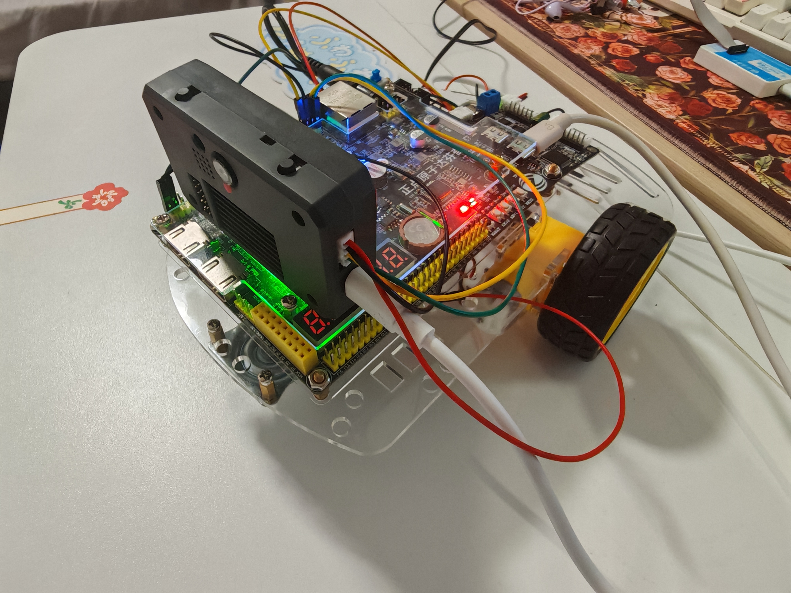

# FPGA连接组数字果蝇

将果蝇连接组中的神经子网络部署到 FPGA，接入 K230 视觉观测、I²C 双轮底盘和实时上位机。



## 系统与贡献

K230 输出视觉观测，Artix-7 FPGA 执行神经计算、模型步调度和执行映射，随后通过 I²C 控制双轮驱动板。上位机提供动作许可、停车、底盘点动、电源检查和运行记录，并呈现三维果蝇。

FPGA 处理 **471 个神经元、44,236 条连接、311 路刺激和 32 槽 DN 输出**，实现连接读取、定点累加与状态更新。项目同时提供逐步状态核对、无损输入压缩和快照审计。

| 项目 | 结果与版本 |
| --- | --- |
| 当前 R13 实现 | 8,669 LUT、10,255 FF、34 BRAM Tile、9 DSP，50 MHz |
| 当前 R13 时序 | WNS +0.226 ns，WHS +0.080 ns，双仿真与布局布线通过 |
| 历史真板状态验证 | 对应历史制品 5400 步全状态精确一致 |
| 历史 O7 传输优化 | 159 个高负载配对帧的平均请求字数减少 65.14% |
| 当前底盘实物记录 | 固定 1800 档点动 0.75 秒，用户确认双轮转动并停下 |

当前持续自动神经驱动的同版实体对应、独立供电冷启动及故障停车时间仍待专门验证。历史严格 50 Hz 测试未通过。三维姿态来自指令示意，车轮实际角度缺少编码器测量。

[技术报告](report/technical_report.pdf) · [实现与历史证据](evidence/) · [源码快照清单](MANIFEST.json)

## 快速运行

使用 Python 3.11+、Node.js 20+。在本地环境安装 requirements.txt 中依赖。

```sh
python -B scripts/verify.py
python -B scripts/verify.py --tests
python -B scripts/simulate.py
```

仿真需要 Icarus，可通过 FLY01_IVERILOG 与 FLY01_VVP 指定可执行文件路径。

启动上位机

```sh
cd panel
node server.mjs
```

打开终端打印的本机地址。上位机启动后处于断开状态，连接、神经开放和底盘点动都由操作者点击执行。真机操作前核对电源、接线与轮子架空状态。

## FPGA 构建

使用 Vivado 2025.2 与 Icarus。可设置 FLY01_VIVADO、FLY01_XVLOG、FLY01_XELAB、FLY01_XSIM、FLY01_IVERILOG、FLY01_VVP。将工程放入 ASCII 路径后运行

```sh
python -B scripts/fpga_auto.py --config fpga/fpga-auto-r13.json
```

构建输出位于 fpga/build_r13。board/ 中的 R13 bit 对应临时配置。历史非易失 Flash 记录仍为 R11，加载和写 Flash 应分别核对准确制品。

## 目录

- fpga/ 包含 R13 RTL、约束、存储输入与短测试。
- panel/ 包含实时上位机、Three.js 依赖及 Meshy 显示模型。
- vision/k230_r5/ 包含 11 月 2 日审计中找到的 K230 源码快照，板端当前程序需现场核对。
- reference/、src/ 与 configs/ 包含冻结软件参考、历史输入和通用接口。
- report/ 包含匿名技术报告和 O7 真实 AI 协作节选。
- skill/ 包含用于状态核对与审计的复用技能。
- evidence/ 区分当前实现、历史核心与手动底盘结果。

## 许可与来源

原创代码采用 [MIT](LICENSE)。第三方数据、依赖与模型的来源及适用条款见 [NOTICE.md](NOTICE.md)。Meshy 显示模型由项目方确认允许公开分发。来源材料与历史版本标识随快照保存。
